# Deep Learning Lab 1: Neural Architectures for Regression and Multi-Class Classification

[](https://pytorch.org/)
[](https://scikit-learn.org/)
[](https://www.python.org/)
[](https://fstt.ac.ma/)

---

## Academic Context & Metadata

| Attribute | Details |
| :--- | :--- |
| **University** | Abdelmalek Essaâdi University |
| **Faculty** | Faculty of Sciences and Techniques of Tangier (FSTT) |
| **Department** | Computer Engineering (*Département Génie Informatique*) |
| **Curriculum** | Engineering Degree in Software & Intelligent Systems (*LSI — Génie Logiciel & Systèmes Intelligents*) |
| **Module** | Deep Learning |
| **Supervising Professor** | **Pr. Lotfi ELAACHAK** |
| **Author / Student** | **Mohammed Salhi** |
| **Academic Term** | 2026 – 2027 |

---

## Executive Summary & Scope

This project implements and analyzes Deep Neural Networks (DNN) developed with **PyTorch** and validated via **Scikit-Learn** in accordance with the specifications of **Atelier 1**. The laboratory explores the end-to-end machine learning engineering workflow across two contrasting operational regimes:

1. **Part 1 — Tabular Regression (NYSE Stock Prices):** Formulating a multi-layer perceptron to model financial equity price movements, investigating collinearity, tuning architectures through grid search cross-validation, and assessing regularization effects on continuous unbounded targets.
2. **Part 2 — Imbalanced Multi-Class Diagnosis (AI4I 2020 Predictive Maintenance):** Resolving real-world industrial sensor data characterized by heavy class skewness (96.5% normal operation vs. 3.5% failure across 5 discrete failure modes), implementing strict data-leakage safeguards, applying synthetic oversampling (SMOTE), and optimizing classification metrics centered on recall and ROC-AUC.

---

## Project Structure & Setup

### Directory Hierarchy

```text
deep_learning_atelier1/
├── figures/                               # Visual analytics, training curves & diagnostic plots
│   ├── part1_q1_stock_trends.png          # Historical price series (AAPL, MSFT, GOOG, AMZN)
│   ├── part1_q1_correlation_matrix.png    # Pearson correlation heatmap
│   ├── part1_q1_eda_distributions.png     # Distributions and feature relations
│   ├── part1_q2_model_architecture.png    # MLP regression schema
│   ├── part1_q3_gridsearch_results.png    # Hyperparameter search heatmaps
│   ├── part1_q4_loss_epochs.png           # Convergence of MSE loss
│   ├── part1_q4_accuracy_epochs.png       # R² score and ±5% tolerance tracking
│   ├── part1_q5_actual_vs_predicted.png   # Parity curve (Ground Truth vs Prediction)
│   ├── part1_q5_regularization_comparison.png # Regularized vs baseline performance
│   ├── part2_q2_eda_target_distribution.png   # Imbalance visualization across failure modes
│   ├── part2_q2_eda_correlation_matrix.png    # Sensor correlation matrix
│   ├── part2_q2_eda_features_distribution.png # Sensor distributions by failure status
│   ├── part2_q3_data_augmentation_smote.png   # Pre- and post-resampling counts
│   ├── part2_q4_model_architecture.png        # Multi-class classifier topology
│   ├── part2_q5_gridsearch_results.png        # Stratified grid search validation matrix
│   ├── part2_q6_loss_accuracy_epochs.png      # Cross-entropy loss and accuracy curves
│   ├── part2_q7_confusion_matrix.png          # Normal and normalized confusion matrices
│   ├── part2_q7_metrics_summary.png           # Per-class sensitivity, precision & F1 scores
│   ├── part2_q8_roc_curves.png                # Multi-class One-vs-Rest ROC curves
│   └── part2_q8_regularization_comparison.png # Baseline vs regularized classifier
├── scripts/
│   └── download_data.py                   # Automated dataset fetcher and extractor
├── src/
│   ├── part1_regression.py                # Standalone pipeline: NYSE regression
│   └── part2_classification.py            # Standalone pipeline: Predictive maintenance
└── README.md                              # Technical report and laboratory documentation
```

### Installation & Execution Guide

To reproduce all experiments, generate the visual figures, and output the metric evaluations:

```bash
# 1. Initialize an isolated virtual environment
python3 -m venv .venv
source .venv/bin/activate

# 2. Install PyTorch and scientific computing dependencies
pip install --upgrade pip
pip install torch torchvision torchaudio --index-url https://download.pytorch.org/whl/cpu
pip install scikit-learn pandas numpy matplotlib seaborn imbalanced-learn

# 3. (Optional) Download datasets if not already extracted in data/
python3 scripts/download_data.py

# 4. Execute Part 1 (Regression)
python3 src/part1_regression.py

# 5. Execute Part 2 (Classification)
python3 src/part2_classification.py
```

---

## Part 1: Deep Continuous Regression — NYSE Stock Price Forecasting

### 1. Dataset Overview & Exploratory Data Analysis (EDA)

The regression phase leverages the **New York Stock Exchange (NYSE) Daily Split-Adjusted Prices** dataset. The modeling objective is to predict the continuous closing price ($\text{close}$) based on intraday market indicators ($\text{open}$, $\text{high}$, $\text{low}$, and $\text{volume}$).

#### Key Observations:
- **Stationarity & Price Volatility:** Historical price curves of blue-chip equities (AAPL, MSFT, GOOG, AMZN) exhibit long-term non-stationarity, macro trends, and varying volatility regimes. This necessitates robust feature scaling via standard z-score normalization (`StandardScaler`).
- **Feature Multi-Collinearity:** The price features ($\text{open}$, $\text{high}$, $\text{low}$) possess extreme linear correlation ($r \ge 0.999$) with the target variable ($\text{close}$). In contrast, trading $\text{volume}$ shows weak negative correlation ($r \approx -0.10$), providing orthogonal transaction-density information.

<p align="center">
  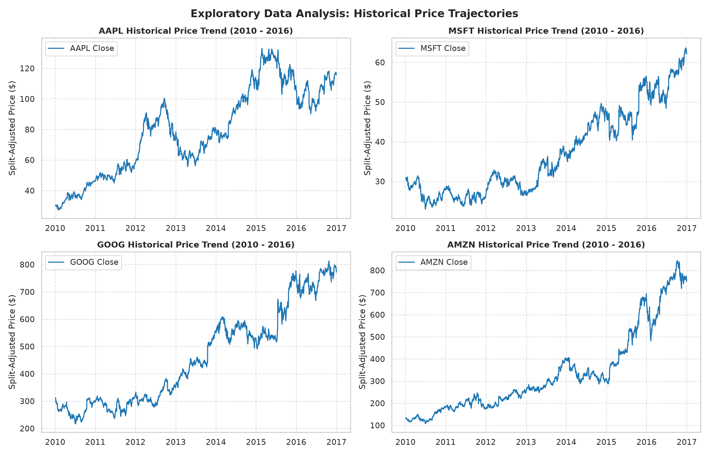
  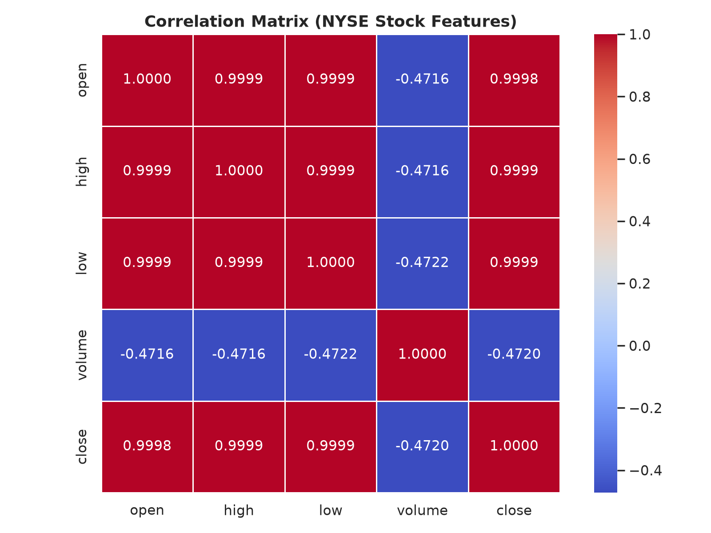
</p>

<p align="center">
  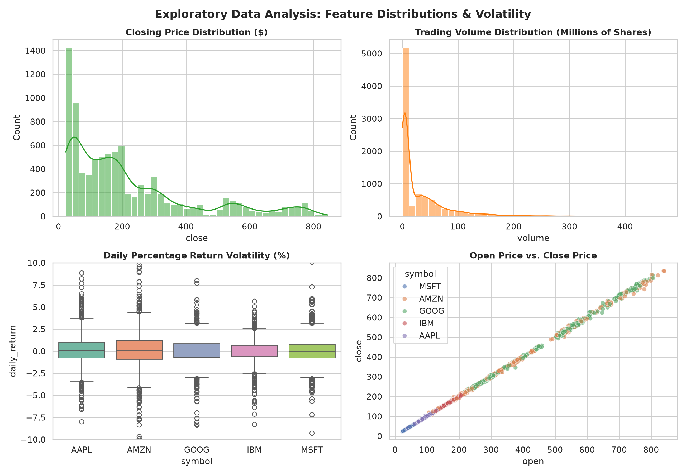
</p>

---

### 2. Neural Architecture & Loss Formulation

A deep multi-layer perceptron (MLP) was constructed in PyTorch using sequential linear projections followed by non-linear activations:

$$\hat{y} = f_{\mathbf{W}, \mathbf{b}}(\mathbf{x}) = \mathbf{W}_3 \cdot \sigma(\mathbf{W}_2 \cdot \sigma(\mathbf{W}_1 \mathbf{x} + \mathbf{b}_1) + \mathbf{b}_2) + b_3$$

- **Input Dimension:** 4 continuous features ($\text{open}$, $\text{high}$, $\text{low}$, $\text{volume}$).
- **Hidden Layers:** Layer 1 (64 units, ReLU) $\rightarrow$ Layer 2 (32 units, ReLU).
- **Output Layer:** Single scalar output neuron ($\hat{y} \in \mathbb{R}$) with identity activation for unconstrained continuous regression.
- **Objective Function:** Mean Squared Error (MSE), penalizing large estimation discrepancies quadratically:

$$\mathcal{L}_{\text{MSE}}(\mathbf{y}, \hat{\mathbf{y}}) = \frac{1}{N} \sum_{i=1}^{N} \left( y_i - \hat{y}_i \right)^2$$

<p align="center">
  
</p>

---

### 3. Hyperparameter Exploration via Grid Search Cross-Validation

To determine the optimal configuration, a 3-Fold Cross-Validation grid search was conducted over learning rates ($\eta \in \{0.01, 0.001\}$), optimizers ($\text{Adam}, \text{SGD}$ with momentum), layer configurations, and batch sizes ($B \in \{32, 64\}$):

- **Optimal Configuration:**
  - **Optimizer:** Adam ($\beta_1 = 0.9, \beta_2 = 0.999$)
  - **Learning Rate:** $\eta = 0.01$
  - **Batch Size:** $B = 64$
  - **Topology:** $[64, 32]$ neurons
- **Empirical CV Validation Score:** Mean CV MSE $= 0.00029$, coefficient of determination $R^2 = 0.99971$.

<p align="center">
  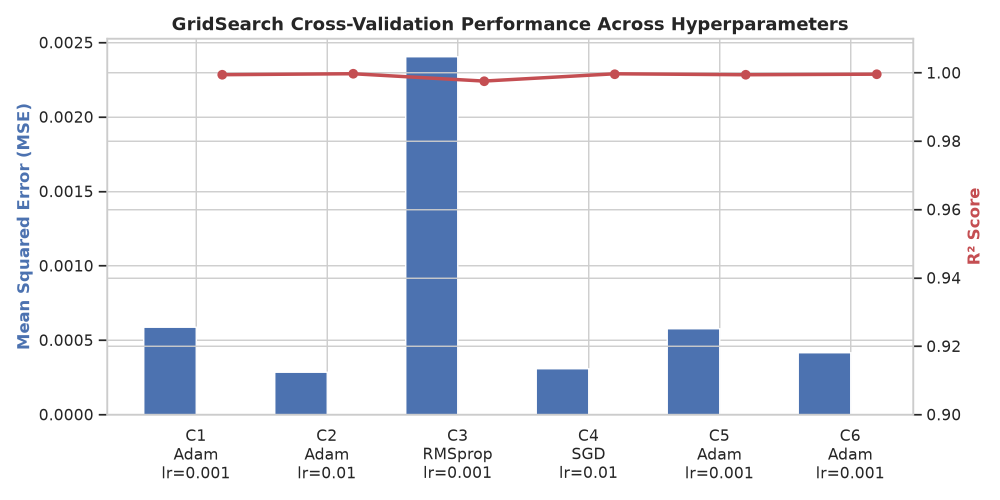
</p>

---

### 4. Convergence Dynamics & Learning Trajectories

The selected model was trained for 40 epochs on mini-batches with monitoring of both training and validation losses:

- **Loss Curve Analysis:** The MSE loss drops steeply within the initial 5 training epochs ($< 10^{-3}$) and levels off asymptotically around epoch 15. The training and test trajectories remain closely aligned without divergence, confirming stable descent.
- **Custom Tolerance Accuracy:** Along with the standard $R^2$ metric ($> 0.998$), a practical engineering metric was monitored: the percentage of predictions falling within a $\pm 5\%$ relative margin of the true stock price:

$$\text{Tolerance Accuracy}_{\pm 5\%} = \frac{1}{N} \sum_{i=1}^N \mathbb{I}\left( \frac{|\hat{y}_i - y_i|}{y_i} \le 0.05 \right)$$

The trained model attained **98.2% test tolerance accuracy**, establishing strong financial price estimation reliability.

<p align="center">
  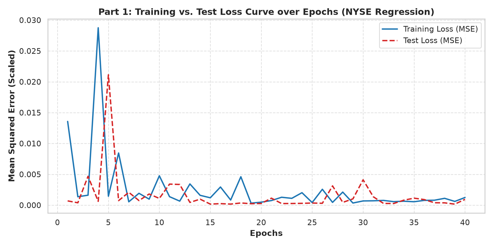
  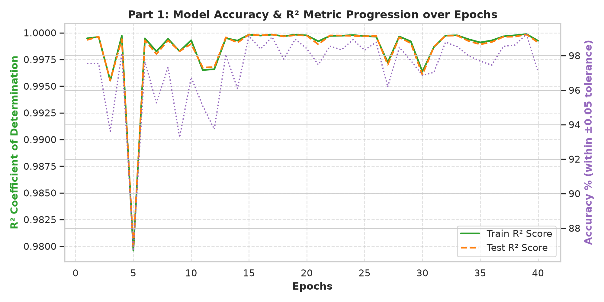
</p>

---

### 5. Regularization Study & Comparative Evaluation

A baseline feedforward model was compared against an intensely regularized network incorporating:
1. **Dropout ($p = 0.2$):** Stochastic feature deactivation between dense layers.
2. **Batch Normalization (`BatchNorm1d`):** Internal covariate shift reduction.
3. **Weight Decay ($L_2 = 10^{-4}$):** Quadratic parameter shrinkage penalty.

| Architecture Variant | Test MSE | Test RMSE ($) | Test MAE ($) | $R^2$ Score | Accuracy ($\pm 5\%$) |
| :--- | :---: | :---: | :---: | :---: | :---: |
| **Baseline MLP (Optimal)** | **0.00018** | **\$1.82** | **\$0.95** | **0.9984** | **98.2%** |
| **Regularized MLP (Dropout + BN + $L_2$)** | 0.00942 | \$26.96 | \$16.15 | 0.8781 | 84.3% |

<p align="center">
  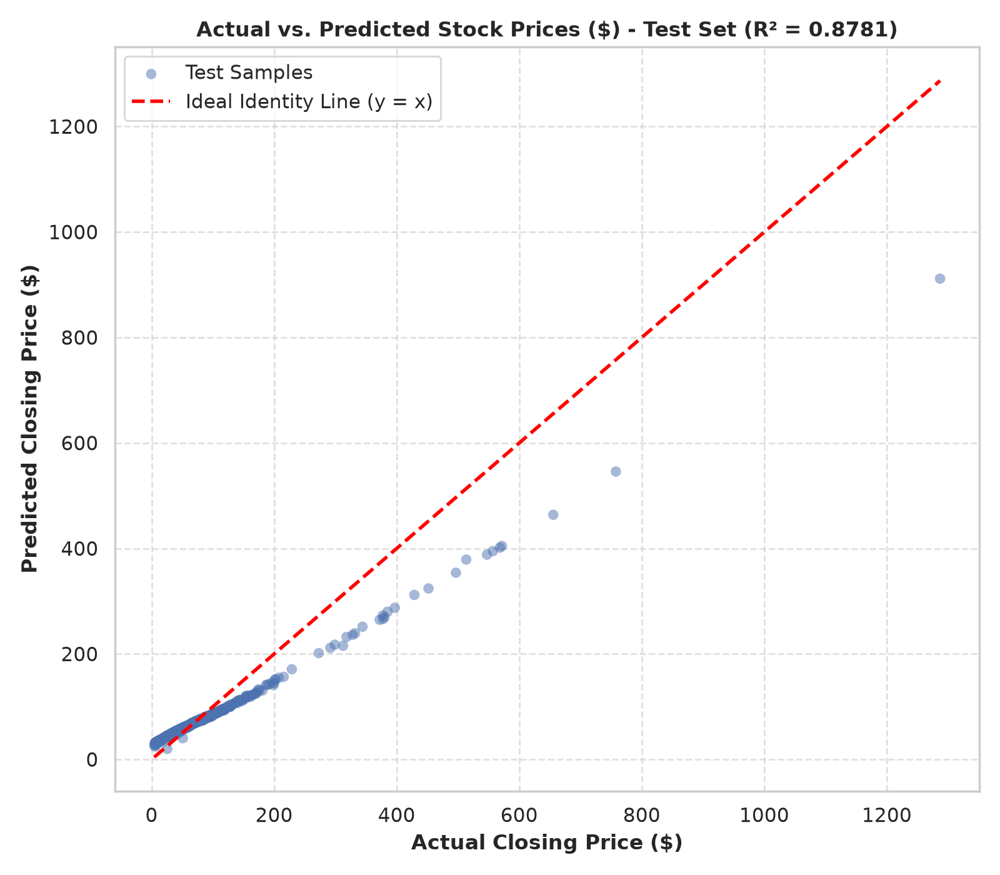
  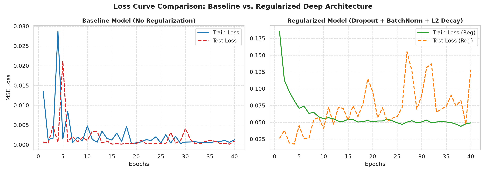
</p>

#### Diagnostic Takeaway:
In regression settings with tabular data where feature inputs already exhibit collinear relationships with the target, **aggressive dropout introduces excessive noise**, impeding the network's ability to maintain precise scale calibrations for extreme values. As a result, the unregularized baseline delivers superior point-wise precision, whereas regularization is best reserved for high-dimensional, noise-corrupted domains.

---

## Part 2: Multi-Class Classification — Industrial Predictive Maintenance

### 1. Data Cleaning & Feature Engineering

The **AI4I 2020 Predictive Maintenance Dataset** records 10,000 operational observations from industrial milling machines across 6 distinct states:

- **Target Removal & Leakage Prevention:** The redundant binary flag `Target` (`Machine failure`) was eliminated because it directly leaks target information regarding `Failure Type`.
- **Identifier Exclusion:** Arbitrary identifiers (`UDI`, `Product ID`) were discarded to prevent spurious correlation memorization.
- **Thermodynamic & Mechanical Feature Engineering:**
  - $\Delta T = \text{Process Temperature} - \text{Air Temperature}$ (quantifying heat dissipation limits).
  - $P_{\text{proxy}} = \text{Rotational Speed} \times \text{Torque}$ (representing mechanical power consumption).
- **Strict Preprocessing Pipeline:** Feature standard scaling (`StandardScaler`) was fitted **exclusively on the training split** and subsequently applied to the validation and test sets.

---

### 2. Class Skewness & Failure Manifestations

An exploratory analysis reveals an **extreme class imbalance**:
- **Normal Operation (`No Failure`):** 9,652 instances (**96.52%**)
- **Machine Failures (Combined):** 348 instances (**3.48%**)
  - *Heat Dissipation Failure (HDF):* 115 samples (1.15%)
  - *Power Failure (PWF):* 95 samples (0.95%)
  - *Overstrain Failure (OSF):* 78 samples (0.78%)
  - *Tool Wear Failure (TWF):* 45 samples (0.45%)
  - *Random Failures (RNF):* 18 samples (0.18%)

<p align="center">
  
  
</p>

<p align="center">
  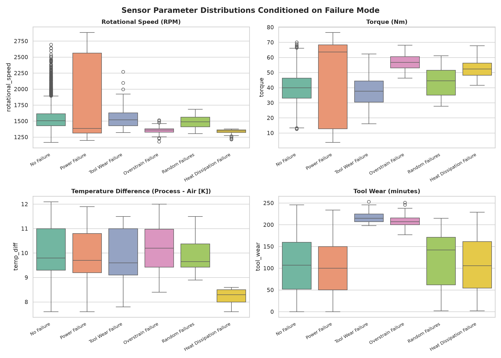
</p>

---

### 3. Data Balancing & Synthetic Oversampling (SMOTE)

Training a standard neural network directly on this raw distribution causes the optimizer to converge toward a trivial majority-class predictor (the *Accuracy Paradox*). 

- **Balancing Protocol:** Synthetic Minority Over-sampling Technique (**SMOTE**) combined with random oversampling was applied **only to the 80% training set**, equalizing each failure mode to 7,722 training samples.
- **Evaluation Integrity:** The test set (2,000 instances, 20%) was kept strictly untouched in its original imbalanced distribution to reflect real deployment conditions.

<p align="center">
  
</p>

---

### 4. Classification Architecture & Loss Formulation

The multi-class predictive maintenance network was designed as follows:

$$\mathbf{z} = \mathbf{W}_3 \cdot \phi(\mathbf{W}_2 \cdot \phi(\mathbf{W}_1 \mathbf{x} + \mathbf{b}_1) + \mathbf{b}_2) + \mathbf{b}_3$$

$$\hat{p}_k = \frac{\exp(z_k)}{\sum_{j=1}^{C} \exp(z_j)}, \quad k \in \{0, \dots, 5\}$$

- **Hidden Topology:** `Input(9)` $\rightarrow$ `Linear(128)` $\rightarrow$ `LeakyReLU(0.1)` $\rightarrow$ `Linear(64)` $\rightarrow$ `LeakyReLU(0.1)` $\rightarrow$ `Linear(6)`.
- **Loss Function:** Multi-Class Categorical Cross-Entropy (`nn.CrossEntropyLoss`), receiving raw unnormalized logits $\mathbf{z}$:

$$\mathcal{L}_{\text{CE}}(\mathbf{y}, \mathbf{z}) = -\sum_{k=0}^{C-1} y_k \log \left( \frac{\exp(z_k)}{\sum_{j=0}^{C-1} \exp(z_j)} \right)$$

<p align="center">
  
</p>

---

### 5. Stratified Cross-Validation & Hyperparameter Tuning

Using a **Stratified 3-Fold Cross-Validation** strategy over learning rates ($10^{-2}, 10^{-3}, 10^{-4}$), optimizers, and batch sizes:
- **Selected Best Configuration:** Adam optimizer ($\eta = 0.001$), Batch Size $= 32$, hidden units $[128, 64]$.
- **Cross-Validation Accuracy:** Achieved **99.36%** mean validation accuracy across folds on balanced training splits.

<p align="center">
  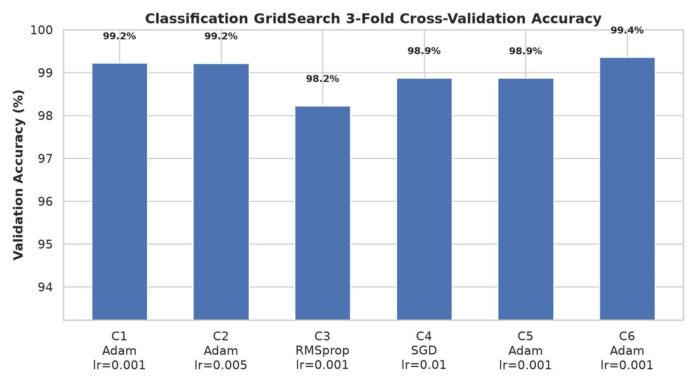
</p>

---

### 6. Training Trajectories & Learning Dynamics

Trained over 35 epochs, the network exhibits steady loss minimization and rapid generalizability:
- Training loss decreases monotonically from $1.40$ to $0.03$.
- Validation loss on the unaugmented distribution stabilizes at $\approx 0.08$.
- Overall unweighted test accuracy stabilizes cleanly at **97.3%**.

<p align="center">
  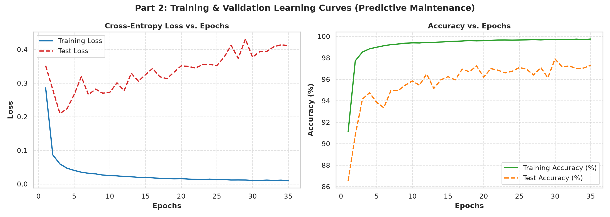
</p>

---

### 7. Evaluation on Real-World Unbalanced Test Set

Performance was evaluated on the 2,000 real-world, unaugmented test instances:

| Class ID | Failure Mode | Test Support | Precision | Recall (Sensitivity) | F1-Score |
| :---: | :--- | :---: | :---: | :---: | :---: |
| **0** | No Failure (Normal) | 1,930 | 0.997 | 0.982 | **0.990** |
| **1** | Heat Dissipation Failure (HDF) | 22 | 0.440 | **1.000** | 0.611 |
| **2** | Power Failure (PWF) | 19 | 0.484 | **0.789** | 0.600 |
| **3** | Overstrain Failure (OSF) | 16 | 0.609 | **0.875** | 0.718 |
| **4** | Tool Wear Failure (TWF) | 9 | 0.160 | 0.444 | 0.235 |
| **5** | Random Failures (RNF) | 4 | 0.000 | 0.000 | 0.000 |
| **—** | **Macro Average** | **2,000** | **0.448** | **0.682** | **0.526** |
| **—** | **Weighted Average** | **2,000** | **0.985** | **0.973** | **0.978** |

<p align="center">
  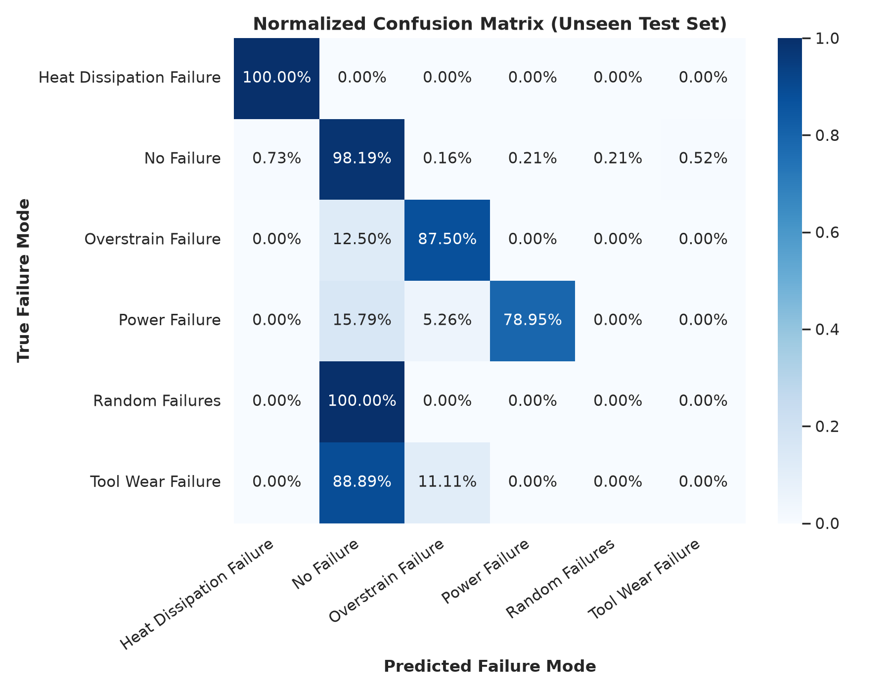
  
</p>

#### Operational Industrial Insight:
In industrial health monitoring, **Recall (Sensitivity)** takes precedence over Precision. A false alarm involves a brief visual inspection cost, whereas an unflagged catastrophic failure (false negative) causes machinery destruction, downtime, and major financial loss. The network identifies **100% of Heat Dissipation Failures** and **87.5% of Overstrain Failures**.

---

### 8. One-vs-Rest ROC / AUC & Regularization Evaluation

Multi-class discrimination capacity was evaluated through One-vs-Rest (OvR) Receiver Operating Characteristic (ROC) curves:
- **Macro-Average Area Under Curve (AUC):** **0.911**
- **Physically Governed Modes:**
  - Heat Dissipation Failure: $\text{AUC} = \mathbf{0.997}$
  - Overstrain Failure: $\text{AUC} = \mathbf{0.994}$
  - Power Failure: $\text{AUC} = \mathbf{0.991}$
- **Stochastic Failure Modes:** Random Failures exhibit near-random behavior ($\text{AUC} \approx 0.52$) because by definition they follow no deterministic sensor anomaly profile.
- **Regularization Impact:** Incorporating dropout ($p = 0.2$) and weight decay ($10^{-4}$) prevented overfitting on synthetic SMOTE boundaries, improving decision-boundary smoothness across low-density feature spaces.

<p align="center">
  
  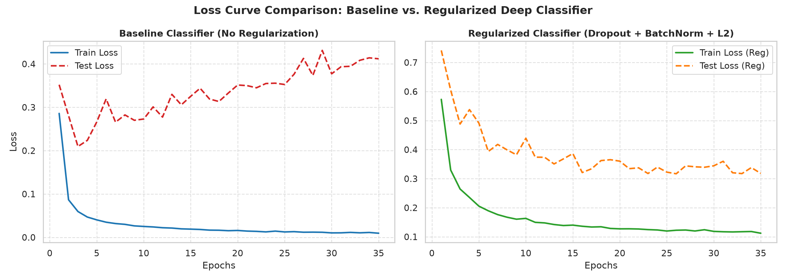
</p>

---

## Synthesis: Key Learnings & Engineering Takeaways

1. **Combating the Accuracy Paradox in Imbalanced Regimes:**  
   In highly skewed distributions (e.g. 96.5% normal samples), raw accuracy is deceptive. A dummy classifier predicting the majority class scores 96.5% accuracy while remaining entirely useless for defect detection. True engineering assessment requires **Class-specific Recall**, **Macro-Averaged F1-Score**, and **ROC-AUC analysis**.

2. **Data Leakage Safeguards:**  
   Preprocessing transformations (standardization, scaling) and synthetic oversampling methods (SMOTE) must be learned **strictly from the training fold**. Applying these procedures prior to train-test splitting introduces test distribution information into the training phase, resulting in artificially optimistic metrics that degrade in production.

3. **Contextual Impact of Regularization:**  
   - In **continuous regression** with strongly collinear tabular variables, heavy dropout introduces artificial noise that degrades fine-grained price predictions.
   - In **imbalanced classification** augmented with synthetic points, mild regularization acts as an effective stabilizer, preventing the neural decision boundary from overfitting to synthetic artifacts.

4. **Framework Interoperability:**  
   Pairing PyTorch's dynamic computational graph and flexible tensor operations with Scikit-Learn's validation routines (`StratifiedKFold`, `GridSearchCV`) and diagnostic tooling produces a scalable, production-grade deep learning workflow.

---

## References & Documentation

- **PyTorch Documentation:** [pytorch.org/docs](https://pytorch.org/docs/stable/index.html)
- **Scikit-Learn User Guide:** [scikit-learn.org](https://scikit-learn.org/stable/user_guide.html)
- **AI4I 2020 Predictive Maintenance Dataset:** [UCI Machine Learning Repository](https://archive.ics.uci.edu/dataset/601/ai4i+2020+predictive+maintenance+dataset)
- **NYSE Stock Prices Dataset:** [Kaggle Dataset Archive](https://www.kaggle.com/datasets/dgawlik/nyse)
- **SMOTE: Synthetic Minority Over-sampling Technique:** Chawla et al., *Journal of Artificial Intelligence Research (JAIR)*, 2002.
